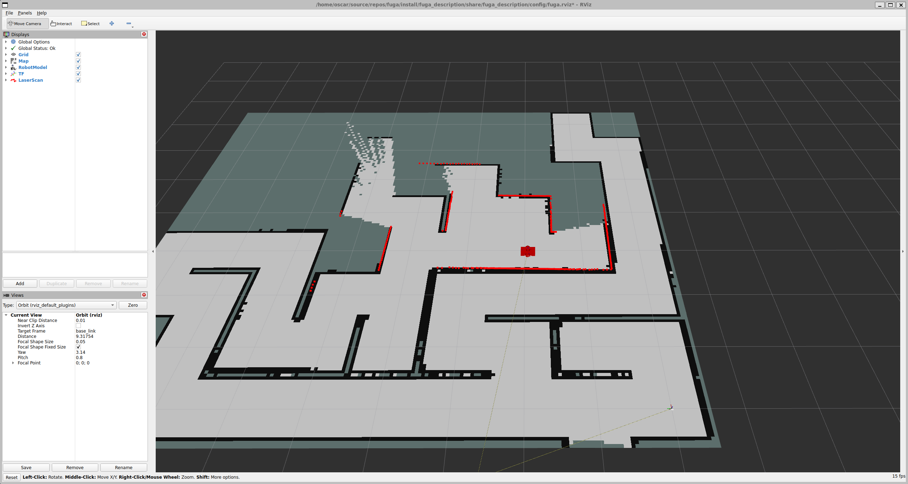

# fuga

Un robot diferencial que tiene que escapar de laberintos generados al azar, simulado
con **ROS 2 Jazzy** y **Gazebo Harmonic**.

El proyecto va por etapas: primero escapar con agentes reactivos (seguir la pared,
Pledge) y medir cómo lo hacen; después construir el mapa con SLAM y navegar sobre él
con Nav2.



*El robot (rojo, en el centro) recorriendo un laberinto. En gris claro, el mapa que
va construyendo slam_toolbox; en rojo, las lecturas del lidar sobre los muros.*

## Qué hay

- **Generador de laberintos** (`maze_gen`): librería C++ sin ROS con 13 algoritmos
  (DFS, Kruskal, Prim, Wilson, Eller…), salidas, habitaciones y un parámetro de
  dificultad que añade bucles e islas. Con la misma `seed` sale siempre el mismo
  laberinto.
- **Exportador a Gazebo** (`maze_export`): convierte el laberinto en un mundo SDF, un
  mapa PGM de referencia y un `meta.yaml` con los límites, la salida y el camino más
  corto.
- **Robot** (`fuga_description`): diferencial con lidar 2D de 360° (10 m), IMU y pose
  real (*ground truth*) para el juez. Incluye el puente Gazebo ↔ ROS y la
  configuración de RViz.
- **Agentes** (`fuga_agents`): seguidor de pared (mano derecha o izquierda) y Pledge,
  elegibles por argumento.
- **SLAM** (`fuga_slam`): slam_toolbox configurado para este robot y `map_iou.py`,
  que compara el mapa de SLAM con el PGM de referencia (IoU, precisión y recall).
- **Juez** (`fuga_eval`): decide si el robot ha salido, en cuánto tiempo y con qué
  recorrido, lo apunta en un CSV y, con SLAM, guarda el mapa y su IoU.
- **Bringup** (`fuga_bringup`): un solo launch para mundo, robot, SLAM, agente y
  juez. Se cierra solo cuando el juez termina, así que se puede lanzar en bucle.

## Estructura

```
tools/maze_gen/          librería de laberintos (C++ puro)
src/maze_gen/            paquete maze_export: maze2world + maze.launch.py
src/fuga_description/    robot (xacro), puente, RViz, spawn.launch.py
src/fuga_agents/         agentes (wall_follower, pledge)
src/fuga_slam/           parámetros y launch de slam_toolbox, map_iou.py
src/fuga_eval/           juez (librería + judge_node)
src/fuga_bringup/        bringup.launch.py
docs/                    notas de aprendizaje e imágenes
knowledge.md             chuleta de comandos y diagnóstico
```

## Requisitos

- Ubuntu 24.04 con ROS 2 Jazzy y Gazebo Harmonic (`ros_gz`).
- `slam_toolbox`, `nav2_map_server`, `teleop_twist_keyboard` y `yaml-cpp`.

El repositorio es el propio workspace de colcon. Las dependencias se instalan con
rosdep:

```bash
git clone https://github.com/oscardiaz1331/fuga.git
cd fuga
source /opt/ros/jazzy/setup.bash
rosdep install --from-paths src tools --ignore-src -r -y
```

## Compilar

```bash
colcon build --symlink-install
source install/setup.bash
```

## Uso rápido

Un solo comando genera un laberinto 10x10, abre Gazebo y RViz, mete el robot, arranca
SLAM, el seguidor de pared y el juez. Cuando el robot sale (o se acaba el tiempo) el
juez escribe el resultado y se cierra todo:

```bash
ros2 launch fuga_bringup bringup.launch.py
```

Algunas variantes:

```bash
ros2 launch fuga_bringup bringup.launch.py agent:=pledge                  # otro agente
ros2 launch fuga_bringup bringup.launch.py width:=15 height:=15 difficulty:=5 seed:=42
ros2 launch fuga_bringup bringup.launch.py start_x:=4 start_y:=4          # robot en la celda (4, 4)
ros2 launch fuga_bringup bringup.launch.py slam:=false rviz:=false        # solo mundo, robot, agente y juez
ros2 launch fuga_bringup bringup.launch.py rtf:=10 step:=0.005 headless:=true rviz:=false  # ~5x más rápido, sin ventanas
ros2 launch fuga_bringup bringup.launch.py --show-args                    # todos los argumentos

# Sin agente ni juez, para conducir a mano
ros2 launch fuga_bringup bringup.launch.py agent:=none
ros2 run teleop_twist_keyboard teleop_twist_keyboard
```

`difficulty` va de 0 a 10: con 10 el laberinto es perfecto (un solo camino, sin
bucles); cuanto más bajo, más bucles e islas, que es justo donde fallan los
seguidores de pared.

Si queda un Gazebo abierto de una ejecución anterior, el bringup no arranca y avisa
(el robot aparecería en el laberinto viejo). Se cierra con
`pkill -f '(^|/)gz sim( |$)'`.

## Resultados

Por defecto todo va a la carpeta del laberinto (`folder`, `/tmp/maze`):

- `results.csv` (argumento `results`): una fila por ejecución con
  `date, algorithm, seed, width, height, difficulty, result, time_s, path_length_m,
  shortest_m, exit_x, exit_y`. `result` es `exit`, `timeout` o `no_start`.
- `maps/` (argumento `maps`, solo con `slam:=true`): el mapa de SLAM (`.pgm` +
  `.yaml`), una imagen con la diferencia frente al laberinto real (`_diff.png`) y
  las métricas (`_iou.json`).

Para comparar agentes, basta un bucle; cada ejecución añade una fila al mismo CSV:

```bash
for seed in 1 2 3; do
  for agent in wall_follower pledge; do
    ros2 launch fuga_bringup bringup.launch.py seed:=$seed agent:=$agent \
      rviz:=false headless:=true rtf:=10 step:=0.005 slam:=false \
      results:=$HOME/fuga_results.csv
  done
done
```

`rtf` es el máximo de veces que la simulación va más rápida que el reloj real, y
`step` el paso de física en segundos. Hacen falta los dos: cada paso tiene un coste
fijo, así que con el paso por defecto (1 ms) Gazebo no pasa de ~1,5x aunque se le
pida más. Con 5 ms, el mismo laberinto da el mismo resultado (tiempo y recorrido) en
menos de la mitad de tiempo real. Los tiempos del CSV son de simulación, así que no
cambian con esto. El factor real se ve con `gz topic -e -t /stats`
(`real_time_factor`).

## Tests

```bash
colcon test --packages-select maze_gen maze_export fuga_description fuga_slam fuga_eval
colcon test-result --verbose
```

## Documentación

- [knowledge.md](knowledge.md): todos los comandos (compilar, lanzar por partes,
  comprobar sensores y TF, SLAM, IoU, diagnóstico de odometría) y el diseño del juez.
- [tools/maze_gen/docs/](tools/maze_gen/docs/README.md): algoritmos, fallos
  corregidos, rendimiento y calidad de código del generador.
- [docs/](docs/): notas sobre conceptos de ROS 2.

## Estado

Hecho:
- Generación de laberintos y exportación a Gazebo.
- Robot simulado con lidar, IMU y odometría.
- Agentes: seguidor de pared y Pledge, elegibles con `agent:=`.
- SLAM online con slam_toolbox.
- Juez: CSV de resultados, mapa SLAM e IoU frente al PGM de referencia.
- Bringup completo que se cierra solo, para baterías de pruebas.

Pendiente:
- Probar el bringup con agente + juez de principio a fin en Gazebo.
- Tests del juez (`Judge`, `PathLength`, CSV y `meta`).
- Diagnosticar la deriva de la odometría.
- Nav2 sobre el mapa de SLAM y un cliente C++ de `NavigateToPose`.

## Licencia

Apache-2.0 (ver el `LICENSE` de cada paquete).
